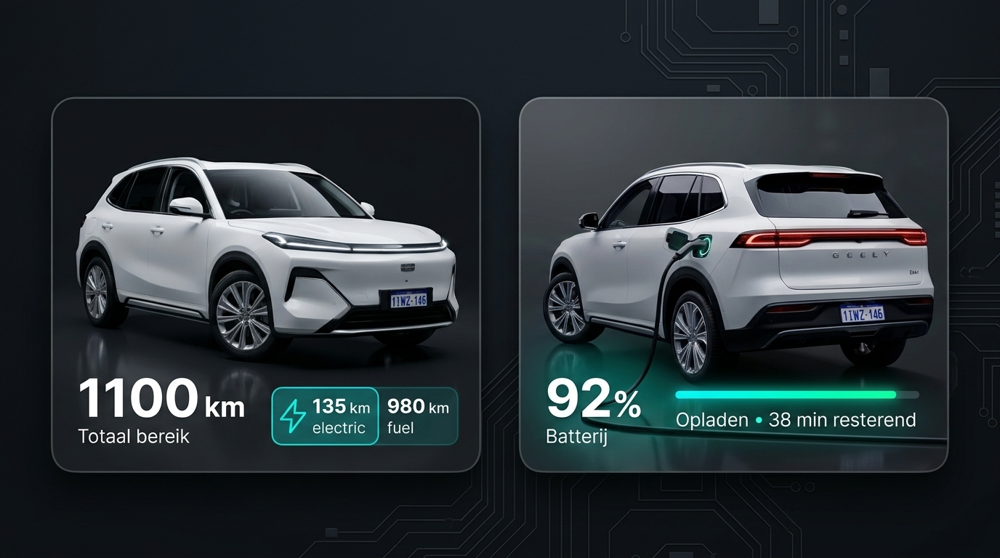
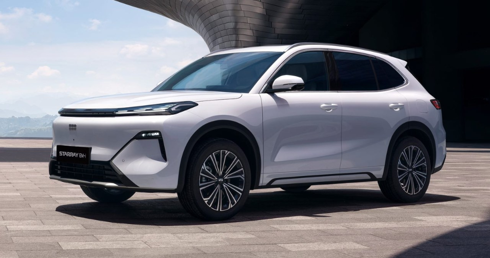
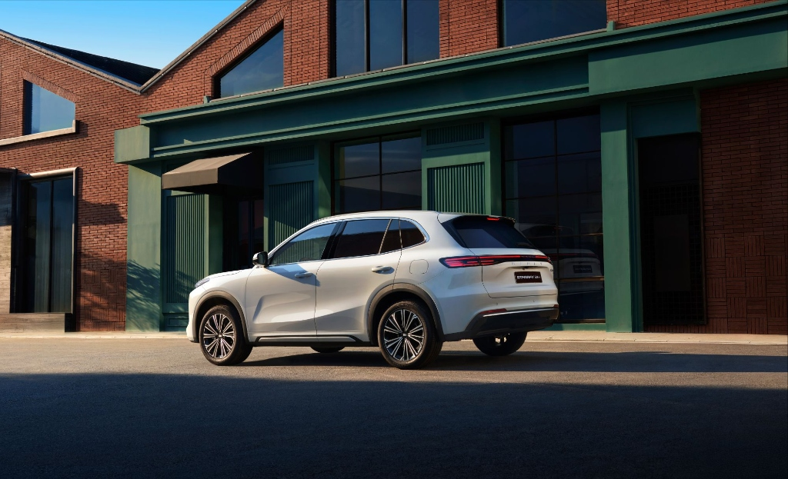
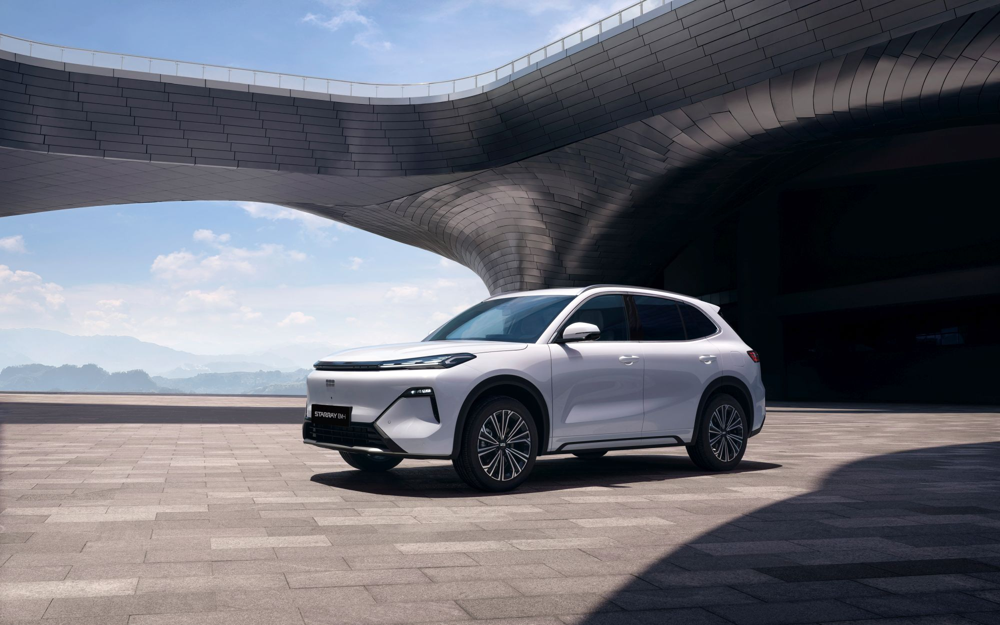
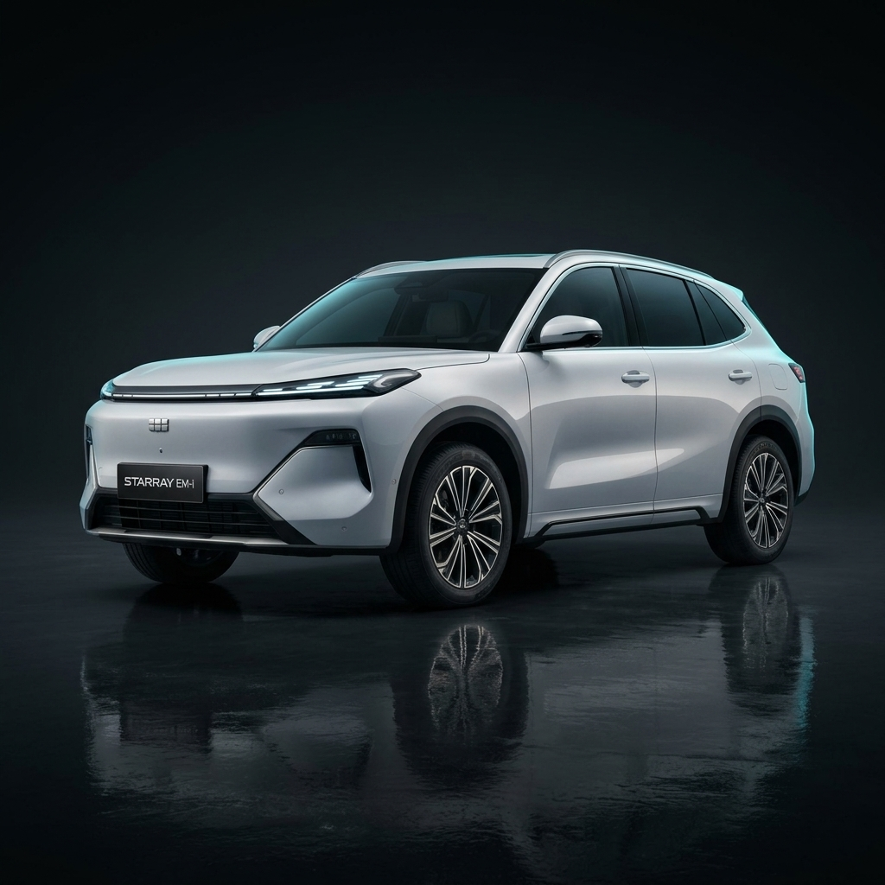
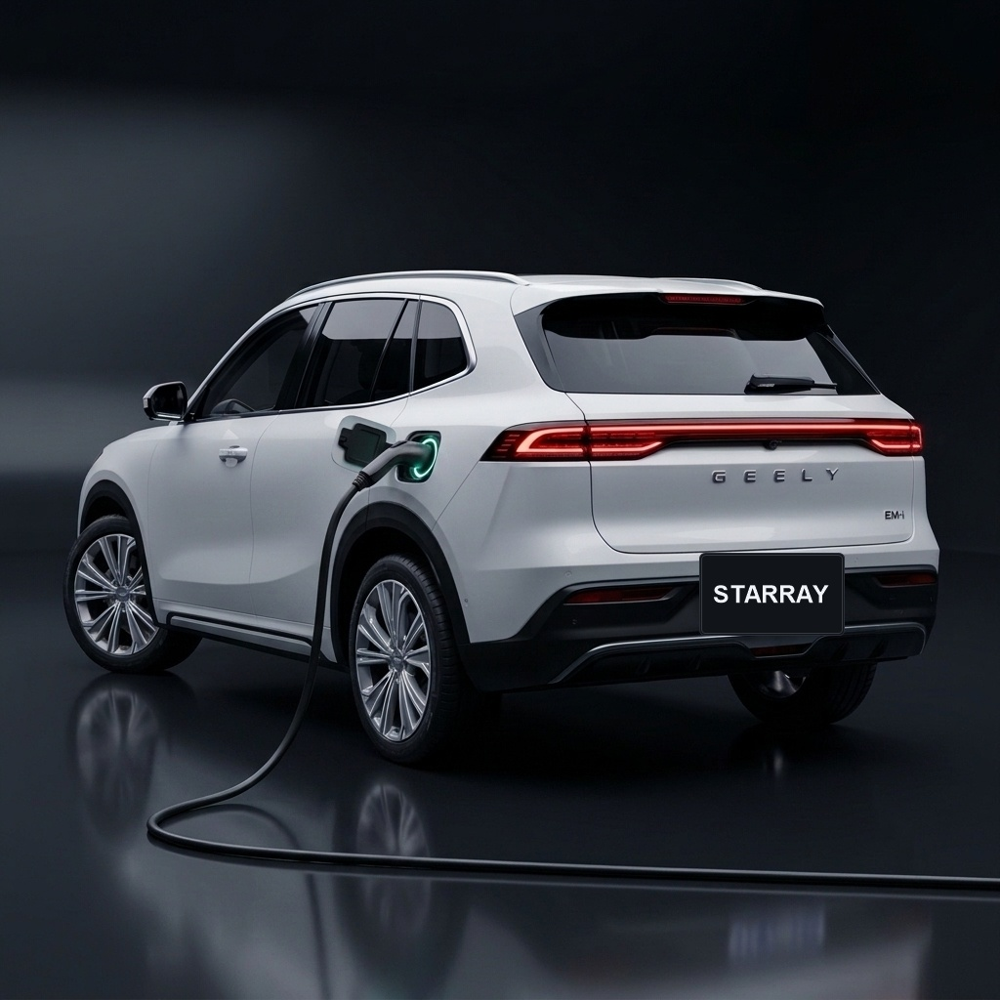
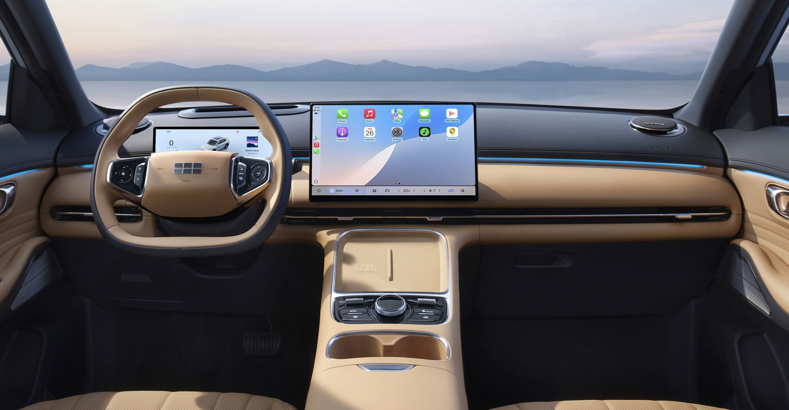

# Geely Starray Card for Home Assistant

Een premium [Home Assistant](https://www.home-assistant.io/) Lovelace dashboard card voor de **2026 Geely Starray EM-i (Wit)**, Geely Boyue L en aanverwante Geely modellen (Super Hybrid, PHEV, BEV en ICE). Geïnspireerd door de officiële Geely Auto / Geely Global mobiele app interface met realtime voertuigtelemetrie, actieradius, laadanimatie en interactieve cockpit-bediening.

Wordt standaard geleverd met **fotorealistische renders van de Geely Starray EM-i in kristalwit**, zowel in Dark Mode als Light Mode, voor geparkeerde en oplaadstatussen.



---

## Screenshots & Visuele Presets

| Preset | Weergave | Beschrijving |
|---|---|---|
| **press_front** |  | **Officiële Europese Persfoto Voorkant (LHD)** met origineel `STARRAY EM-i` showroomkenteken |
| **press_rear** |  | **Officiële Europese Persfoto Achterkant (LHD)** met `STARRAY EM-i` showroomkenteken |
| **plaza** |  | **Europese Lancering Persfoto** (Warschau Architectuur Plaza) |
| **studio_dark** |  | **Studio Render Donker** (1:1 naadloze studio achtergrond) |
| **charging** |  | **Oplaadmodus** met pulserende cyaan/emerald laadgloed en kabel |
| **cockpit** |  | **LHD Cockpit & 15.4" Flyme Auto Touchscreen** |

---

## Belangrijkste Eigenschappen

- 🛠️ **Visuele Kaart Editor (GUI):** Volledige ondersteuning voor de Home Assistant dashboard editor (`geely-starray-card-editor`). Stel sensoren, header-stijl, voertuigafbeelding-presets en beeldverhouding grafisch in via keuzelijsten — geen YAML vereist!
- 🚗 **Officiële Europese Persfoto's met STARRAY EM-i Kenteken:** Uitgerust met de officiële Europese introductiefoto's van de Starray EM-i. Geen buitenlandse of willekeurige nummerborden!
- 📐 **Aanpasbare Beeldverhouding (Aspect Ratio):** Kies tussen `1 / 1` (standaard vierkant dashboard), `16 / 10` (optimaal voor breedbeeld autofotografie) of `16 / 9` / `4 / 3`.
- ⚡ **Europese 18.4 kWh EM-i Specificaties:** Geoptimaliseerd voor de Europese Starray EM-i met 18.4 kWh Aegis accu (~83 km WLTP elektrisch bereik) en 51L tank (~890 km benzinebereik), totaal circa 968 km.
- 🔌 **Realtime Laadstatus & Pulse Glow:** Geanimeerde emerald/cyaan pulserende laadgloed bij de laadpoort en aangesloten laadkabel weergave.
- 📱 **Geely App Header Modus:** Kies tussen de standaard actieradius-weergave (`header: classic`) of de officiële Geely App stijl (`header: app`) met groot batterijpercentage en elektrische/benzine badges.
- 🔒 **Interactieve Cockpit Bediening:** Tik op de kaart om een modern actievenster te openen met knoppen voor:
  - Deurslot vergrendelen / ontgrendelen
  - Klimaatregeling / Standkachel (AC pre-conditioning)
  - Voorruitverwarming / Ontdooien (Defrost)
  - Kofferbak ontgrendelen
  - Claxon & Knipperlichten (Zoek mijn auto)
- 🇳🇱 **Volledig Nederlandstalig:** Standaard voorzien van Nederlandse labels (`Ontgrendeld`, `Vergrendeld`, `Opladen`, `resterend`, etc.), eenvoudig aanpasbaar via `labels:`.

---

## Installatie

### Optie 1: Via HACS (Aanbevolen)

1. Open **HACS** in Home Assistant en ga naar **Frontend**.
2. Klik rechtsboven op het menu met drie puntjes (**⋮**) → **Aangepaste repositories (Custom repositories)**.
3. Voeg de repository URL toe en selecteer de categorie **Dashboard**.
4. Zoek naar **Geely Starray Card**, klik op downloaden en vernieuw je browser.

### Optie 2: Handmatige Installatie (Zonder HACS)

1. Download het bestand `geely-starray-card.js` uit deze repository.
2. Plaats `geely-starray-card.js` in de map `config/www/` van je Home Assistant installatie.
3. Kopieer eventueel de map `assets/` naar `config/www/assets/`.
4. Ga in Home Assistant naar **Instellingen → Dashboards → ⋮ (rechtsboven) → Bronnen (Resources)**.
5. Klik op **Bron Toevoegen**, stel de URL in op `/local/geely-starray-card.js` en het type op **JavaScript-module**.

---

## Dashboard Configuratie (YAML)

Voeg een kaart toe aan je dashboard met type `custom:geely-starray-card` (of `custom:geely-car-card`):

### 1. Geely Starray EM-i (Super Hybrid / PHEV)

```yaml
type: custom:geely-starray-card
name: Geely Starray EM-i
header: classic # 'classic' (totaal bereik) of 'app' (batterij-eerst)
entities:
  # Batterij & Elektrisch
  battery: sensor.geely_starray_battery_percentage
  electric_range: sensor.geely_starray_electric_range
  
  # Brandstof & Tank
  fuel_range: sensor.geely_starray_fuel_range
  fuel_level: sensor.geely_starray_fuel_level # percentage of liters
  fuel_tank_capacity_l: 51 # inhoud brandstoftank in liters

  # Laden
  charging_connection_status: binary_sensor.geely_starray_charger_plug
  charging_status: sensor.geely_starray_charging_status
  charging_time_left: sensor.geely_starray_time_to_full_charge

  # Beveiliging & Locatie
  lock: lock.geely_starray_doors
  location: device_tracker.geely_starray_location

  # Cockpit Bedieningsknoppen
  climate: switch.geely_starray_ac
  defrost: switch.geely_starray_defrost
  unlock_trunk: button.geely_starray_unlock_trunk
  find_car: button.geely_starray_find_car
```

### 2. Geely App Stijl (Header: App)

Met `header: app` toont de kaart de weergave uit de Geely smartphone app: groot batterijpercentage bovenaan en badges voor elektrisch bereik en benzinebereik daaronder:

```yaml
type: custom:geely-starray-card
name: Starray EM-i
header: app
entities:
  battery: sensor.geely_starray_battery_percentage
  electric_range: sensor.geely_starray_electric_range
  fuel_range: sensor.geely_starray_fuel_range
  charging_connection_status: binary_sensor.geely_starray_charger_plug
  charging_status: sensor.geely_starray_charging_status
  charging_time_left: sensor.geely_starray_time_to_full_charge
  lock: lock.geely_starray_doors
```

### 3. Aangepaste Afbeeldingen (Optioneel)

Standaard gebruikt de kaart de ingebouwde renders van de witte 2026 Starray EM-i. Wil je je eigen foto's of specifieke sensoren gebruiken:

```yaml
type: custom:geely-starray-card
name: Mijn Geely Starray
images:
  parked: /local/assets/starray-white-parked-dark.jpg
  charging: /local/assets/starray-white-charging-dark.jpg
entities:
  ...
```

### 4. Shelly Wall Display (X2i) & Compacte Dashboards

Voor muurschermen met beperkte hoogte (zoals het **Shelly Wall Display X2i** met een effectieve Lovelace viewport van ~415 px) is er een speciale compact-modus die perfect schaalt zonder verticale scrollbars:

```yaml
type: custom:geely-starray-card # of custom:geely-car-card
name: Geely Starray EM-i
compact: true # Activeert compacte typografie en badges
aspect_ratio: 16/10 # Slanke breedbeeldverhouding (past perfect onder je klimaat- of laadcockpit)
image_preset: press_front # Europese persfoto met origineel STARRAY EM-i kenteken
entities:
  battery: sensor.geely_starray_battery_percentage
  electric_range: sensor.geely_starray_electric_range
  fuel_range: sensor.geely_starray_fuel_range
  fuel_level: sensor.geely_starray_fuel_level
  charging_connection_status: binary_sensor.geely_starray_charger_plug
  charging_status: sensor.geely_starray_charging_status
  charging_time_left: sensor.geely_starray_time_to_full_charge
  lock: lock.geely_starray_doors
  location: device_tracker.geely_starray_location
  climate: switch.geely_starray_ac
  defrost: switch.geely_starray_defrost
  unlock_trunk: button.geely_starray_unlock_trunk
  find_car: button.geely_starray_find_car
```

---

## Entiteiten Referentie (`geely-connect` & `geely-global-ha`)

De kaart is ontworpen om direct te werken met integraties zoals **`YossiKon/geely-connect`** en **`nitaybz/geely-global-ha`**:

| Kaart Optie | Type | Beschrijving | Voorbeeld Entiteit |
|---|---|---|---|
| `battery` | Sensor | Batterij SoC in % | `sensor.starray_battery_percentage` |
| `electric_range` | Sensor | Elektrische actieradius | `sensor.starray_electric_range` |
| `fuel_range` | Sensor | Benzine actieradius | `sensor.starray_fuel_range` |
| `fuel_level` | Sensor | Brandstofniveau in % of L | `sensor.starray_fuel_level` |
| `charging_connection_status` | Binary/Sensor | Laadkabel aangesloten | `binary_sensor.starray_charger_plug` |
| `charging_status` | Sensor | Laadstatus (`charging`, etc.) | `sensor.starray_charging_status` |
| `charging_time_left` | Sensor | Resterende laadtijd (minuten/uren) | `sensor.starray_time_to_full_charge` |
| `lock` | Lock | Deurvergrendeling | `lock.starray_doors` |
| `location` | Device Tracker | Voertuig GPS locatie | `device_tracker.starray_location` |
| `climate` | Switch/Button/Climate | Standkachel / Airco | `switch.starray_ac` of `climate.starray` |
| `defrost` | Switch | Voorruitverwarming / Max ontwasemen | `switch.starray_defrost` |
| `unlock_trunk` | Button/Cover | Kofferbak openen | `button.starray_unlock_trunk` |
| `find_car` | Button | Claxonneren & knipperen | `button.starray_find_car` |

---

## Aanpasbare Labels / Vertalingen

Alle teksten kunnen per kaart worden aangepast in het `labels:` blok:

```yaml
type: custom:geely-starray-card
entities:
  ...
labels:
  unlocked: Ontgrendeld
  locked: Vergrendeld
  scheduled: Gepland
  charging: Opladen
  plugged_in: Aangesloten
  lock: Vergrendelen
  unlock: Ontgrendelen
  climate: Klimaatregeling
  defrost: Ontdooien
  trunk: Kofferbak
  find_car: Zoeken
  electric: elektrisch
  fuel: brandstof
  fuel_level: Brandstof
  time_left: resterend
  total_range: Totaal bereik
  battery: Batterij
```

---

## Licentie

Uitgegeven onder de [MIT Licentie](LICENSE). Gebaseerd op en uitgebreid vanuit het originele concept van `ha-volvo-card` door Ruud Mens, herontworpen en geoptimaliseerd voor Geely Starray voertuigen.
